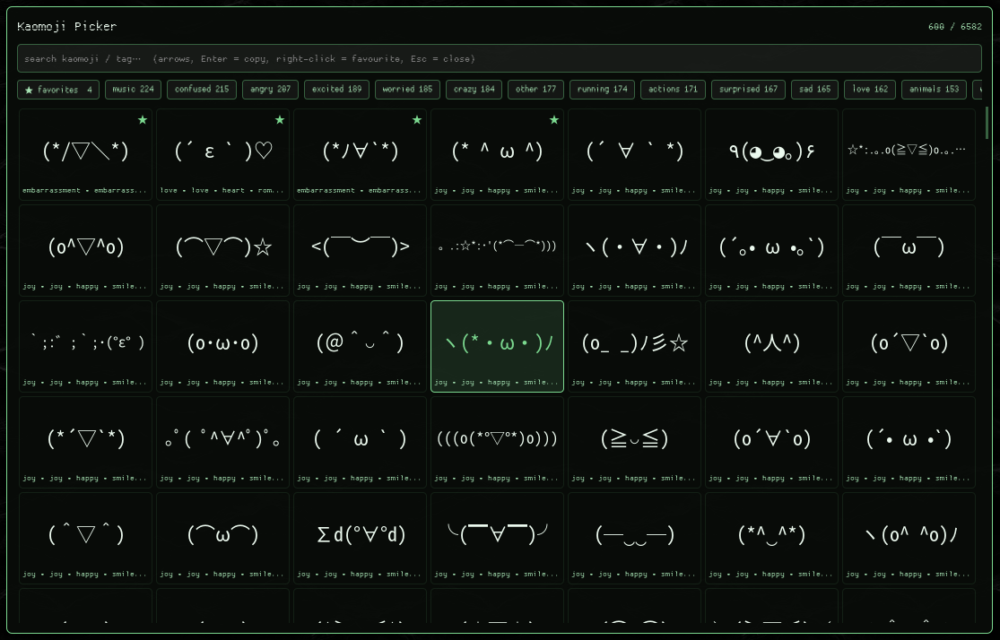

# kaomoji-picker (ﾉ◕ヮ◕)ﾉ*:･ﾟ✧

A tray app that opens a searchable grid of **6582 kaomoji**, copies the face you pick and
pastes it into whatever you were typing in.



Two builds, one dataset, one look:

| Platform | Download | What it is |
|---|---|---|
| **Windows 10/11** | [kaomoji-picker.exe →](../../releases) | Single ~3.9 MB exe, no runtime, no installer (¬‿¬) |
| **Linux** | [KaomojiPicker-x86_64.AppImage →](../../releases) | ~2.6 MB AppImage, GTK3 + StatusNotifier tray, X11 or Wayland |

Grab the newest file from **Releases** on whichever mirror you prefer:

- `https://git.pax.moe/pax/kaomoji-picker/releases` (source of truth)
- `https://github.com/pxlwh/kaomoji-picker/releases` (mirror, updated from the above)

Nothing else to install. No account, no telemetry, no network calls. (￣︶￣)

---

## What it does

Type `sad`, get 406 faces laid out as a grid that fills the window — arrows move, `Enter`
picks, that's it.

| | | | | |
|---|---|---|---|---|
| (╥﹏╥) | (｡•́︿•̀｡) | (´；ω；`) | (T_T) | (ಥ﹏ಥ) |
| (ノ_<) | (つ﹏⊂) | orz | (｡╯︵╰｡) | (◞‸◟；) |

- **Mosaic grid** that auto-fits the window, not a boring one-per-row list (・ω・)ノ
- **Search that actually finds things.** The sites name their own faces, so we harvest those
  labels: `koala` finds `ʕ •ᴥ•ʔ` because someone called it *Koala Bear*, `creepy smile`
  matches because *Creepy Smile* is its name on another site. Synonyms from every source are
  merged onto the same face, so one face answers to *joy*, *happy*, *smile* and *cute*.
- **Shorthand groups**: `gf` → girlfriend/love/heart/kiss, `idk` → shrug/unsure/dunno,
  `flip`, `ily`, `yawn`, `gg`, `omg`, `nsfw`, and a trailing-`s` fallback (｀・ω・´)
- **Category chips** across the top — 105 of them, biggest first, scroll sideways.
  Click one to filter, click again to clear.
- **Favourites**: right-click a tile to star it (★), favourites jump to the front and get
  their own chip.
- **One hex themes everything.** Type `#3fa9f5` in settings and the panel, borders, text,
  chips *and the tray icon* turn blue. Pick `#ff6fae` for the default pink (´｡• ᵕ •｡`)♡
- **Picks and pastes**: the face lands on your clipboard and straight into the window you
  came from — one keystroke, no alt-tab dance (~˘▾˘)~

## Using it

**Windows**
- `Ctrl+Alt+K` opens the picker (rebindable). Type to filter, arrows to move, `Enter` to
  pick, `Esc` to close.
- Tray heart: left click opens the picker, right click for Settings / Reload data / Exit.
- Settings: hotkey, accent hex, start with Windows, paste-after-picking, always-on-top,
  open on the monitor with the cursor, show tags under faces.
- Config lives in `%APPDATA%\KaomojiPicker\` (`settings.json`, `favorites.json`).

**Linux**
- Tray heart: middle click opens the picker (AppIndicator never reports left clicks, so
  left click opens the menu). Same search, same chips, same stars.
- No portable global hotkey exists on Wayland, so the app listens on a socket: wire
  `kaomoji-picker --toggle` (or the AppImage with `--toggle`) to a key in your DE. On X11
  the window opens under the mouse; on Wayland the compositor decides.
- Config lives in `~/.config/kaomoji-picker/` (`settings.json`, `favorites.json`).

## Building from source

Both builds are pure Go with no third-party modules. The Windows one is Win32 via
`syscall` and cross-compiles from anywhere; the Linux one uses hand-written cgo bindings
against GTK3 and Ayatana AppIndicator.

```
# Windows exe
cd windows
GOOS=windows GOARCH=amd64 CGO_ENABLED=0 go build -trimpath \
  -ldflags "-H windowsgui -s -w" -o kaomoji-picker.exe .

# Linux binary + AppImage
cd linux
make build
make appimage        # KaomojiPicker-x86_64.AppImage
make test            # vet, unit tests, headless --selftest
```

Both binaries embed the data and the heart icon, so a build is a single file. GTK and
AppIndicator are linked from the system on Linux (glibc ≥ 2.34).

Headless checks, no display needed:

```
./kaomoji-picker --selftest --out /tmp/report.json
APPIMAGE_EXTRACT_AND_RUN=1 ./KaomojiPicker-x86_64.AppImage --selftest --out /tmp/app.json
```

The self-test loads the data, runs seven fixed queries, checks favourites pinnning and a
disk round-trip, and asserts the derived palette clears its WCAG contrast floors. (•̀ᴗ•́)و

## Where the kaomoji come from

Faces and their labels are scraped by a small fetcher from three public collections:

- [kaomoji.you](https://kaomoji.you/en/) — (`^ω^`) classic
- [emoticoncentral.com](https://emoticoncentral.com) — (◦˙▽˙◦) the ones with human names
- [japaneseemoticons.me](https://japaneseemoticons.me) — ヽ(・∀・)ﾉ the big one

Duplicates across sites are merged, not dropped, so a face keeps every name it was given.
`linux/Makefile`'s `data` target rebuilds `kaomoji.json` from the fetcher's cache. Site
content belongs to those sites; the picker just searches it.

## License

MIT for the code. See [LICENSE](LICENSE). The kaomoji themselves are not ours to license —
they are a shared internet folk art (っ˘ω˘ς)
